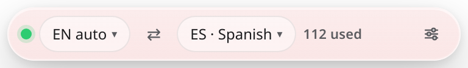
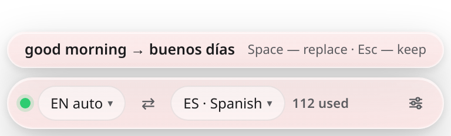
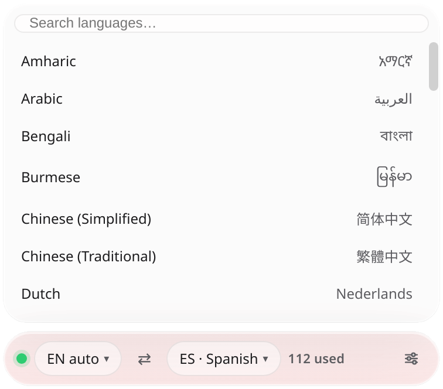
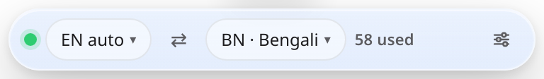
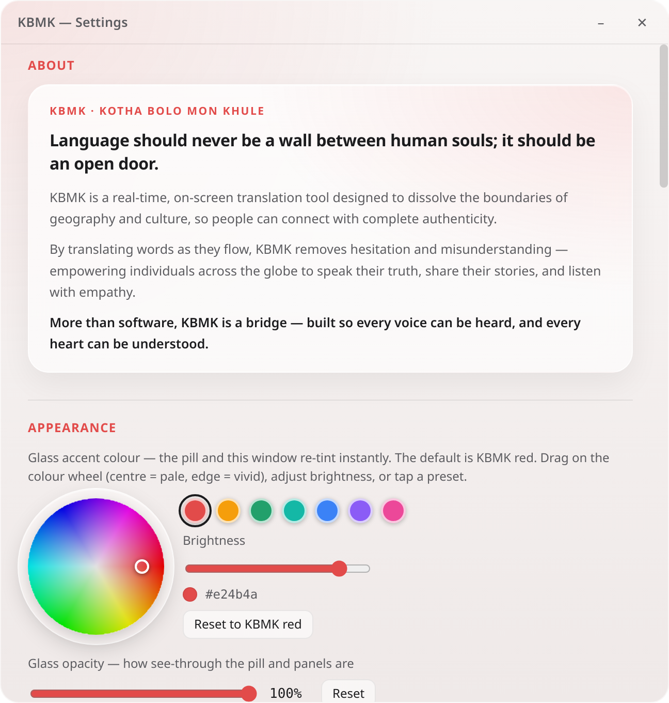
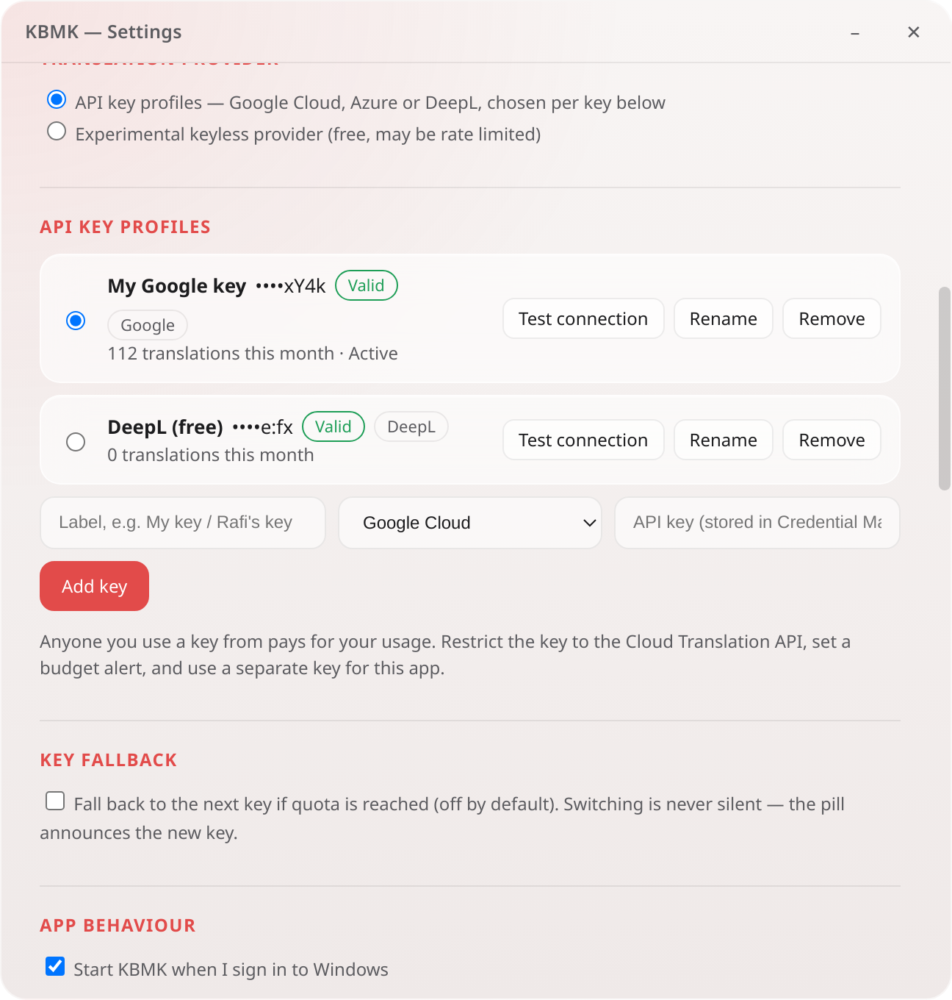
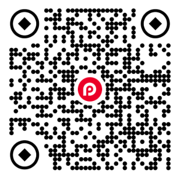
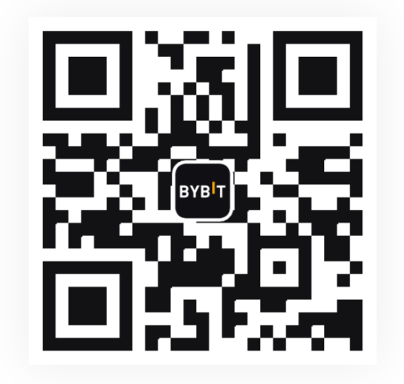

  

  
  
  
  

<strong>Type a word. Press space. It's translated — in any app.</strong>

KBMK (**Kotha Bolo Mon Khule**) is a small system-tray app that translates
the words you type — in *any* app — the moment you finish them. Type a
word, press space, and its translation takes its place. Paste text
instead, and KBMK offers the translation in a little glass pill: one
keypress swaps it in, another keeps your text untouched.

It speaks Bengali (including text typed with Avro Keyboard) and 100+
languages, through your own API key from Google Cloud Translation,
Microsoft Azure Translator, or DeepL — plus an experimental keyless mode.

📖 **Full manual:** [USER_MANUAL.md](USER_MANUAL.md) ·

---

## Screenshots

   
  <em>The glass pill — source and target languages, and your key's usage at a glance.</em>

   
  <em>Paste offers — paste text, then press Space to swap in the translation, or Esc to keep yours.</em>

   
  <em>100+ languages, with native names — and search understands aliases like “bangla”.</em>

   
  <em>Make it yours — the glass colour and opacity are yours to pick.</em>

  
   
  <em>Settings — the colour wheel, and your key profiles (Google, Azure, DeepL side by side).</em>

## Features

- **Type & translate, anywhere** — finish a word with a space or
  punctuation and the translation replaces it in place, in whatever app
  you are using. If you keep typing instead, your text is left alone.
  Repeated words are instant (they are cached).
- **Paste offers** — paste a word, a phrase, or a short sentence
  (Ctrl+V, Shift+Insert, or right-click → Paste) and a glass modal shows
  `pasted → translation`. **Space** replaces, **Esc** keeps. One line at
  a time, up to 300 characters.
- **Undo & pause hotkeys** — Ctrl+Alt+Z undoes the last replacement;
  Ctrl+Alt+T pauses/resumes KBMK from anywhere.
- **100+ languages** — the language menus follow your active key's
  provider list, and search matches aliases (try “bangla”). Bengali is
  fully supported, including text typed with **Avro Keyboard**.
- **Per-app block list** — KBMK never captures anything in blocked apps.
  Password managers are blocked by default, and you can block any app,
  including picking from the windows open right now.
- **Glass customisation** — pick the glass colour from a colour wheel
  (default: KBMK red) and set the glass opacity; the pill re-tints live.
- **Your keys, your choice** — keep several key profiles, switch the
  active one, and optionally fall back to the next key when one runs out
  of quota (KBMK always announces the switch on the pill — never silent).

## Providers

| Provider | What you need | Notes |
| --- | --- | --- |
| **Google Cloud Translation** | An API key | 100+ languages, including Bengali. Restrict the key to the Cloud Translation API and set a budget alert. |
| **Microsoft Azure Translator** | A key + its region | Free F0 tier includes 2M characters/month. Bengali supported. |
| **DeepL** | An API key | Free keys end in `:fx` and are detected automatically. ~35 languages — **DeepL does not include Bengali**. |
| **Keyless (experimental)** | Nothing | No key needed; quality and reliability vary. |

Anyone you use a key from pays for your usage — use a separate key for
this app. Keys are stored **only** in Windows Credential Manager, never
in files, settings exports, or logs.

## Privacy

- Keystrokes are **never** written to disk, logged, or sent anywhere
  except the single finished word/phrase you trigger a translation for,
  which goes to *your chosen provider* with *your key*.
- **No telemetry, no analytics, no accounts, no ads.**
- API keys live only in Windows Credential Manager. Settings export
  contains labels, counters and statuses — **never keys**.
- Your keys and settings live on *your PC only* (Credential Manager +
  `%APPDATA%`) — never inside the app or the installer. A fresh install
  on another PC starts empty, and Settings → **Start over** wipes a PC
  completely.

## Download

Grab the latest build from the **[Releases page](../../releases)**:

- **Windows — Installer (recommended):** `KBMK Setup 0.6.2.exe` — a
  per-user installer (no admin rights needed) with Start Menu and
  desktop shortcuts.
- **Windows — Portable:** `KBMK-Portable.exe` — a true single file;
  carry it anywhere and run it as-is.
- **Linux:** the `.AppImage` — make it executable (`chmod +x`) and run.
- **macOS:** the `.dmg` (or the `.zip`) containing `KBMK.app`.

> **Unsigned builds:** Windows SmartScreen will warn on first run —
> choose **More info → Run anyway**. On macOS, right-click the app →
> **Open** to pass Gatekeeper.

> **Platform note:** KBMK's heart — global key capture, in-place text
> replacement, paste offers, the per-app block list — is Windows
> machinery today. The Linux and macOS builds run the full interface,
> settings and translation providers, and degrade gracefully where a
> Windows-only piece is missing, but typing/paste replacement is
> Windows-only for now.

## Hotkeys

| Keys | Action |
| --- | --- |
| **Space** | Accept a paste offer (replace the pasted text) |
| **Esc** | Dismiss a paste offer (keep the pasted text) |
| **Ctrl+Alt+Z** | Undo the last replacement (typed or pasted) |
| **Ctrl+Alt+T** | Pause / resume KBMK anywhere |

## Support

KBMK is free. If it helps you speak across the wall, you can support its
development by scanning any of these codes:

  
  
  

---

<em>More than software, KBMK is a bridge — built so every voice can be heard, and every heart can be understood.</em>

